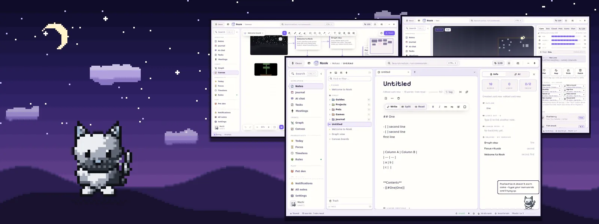
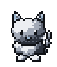
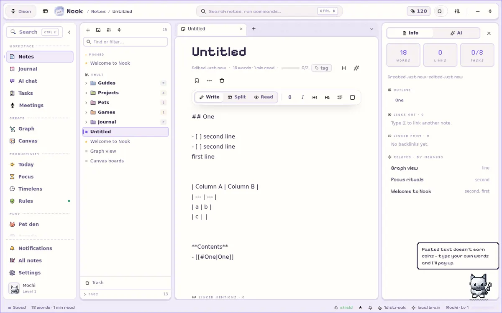
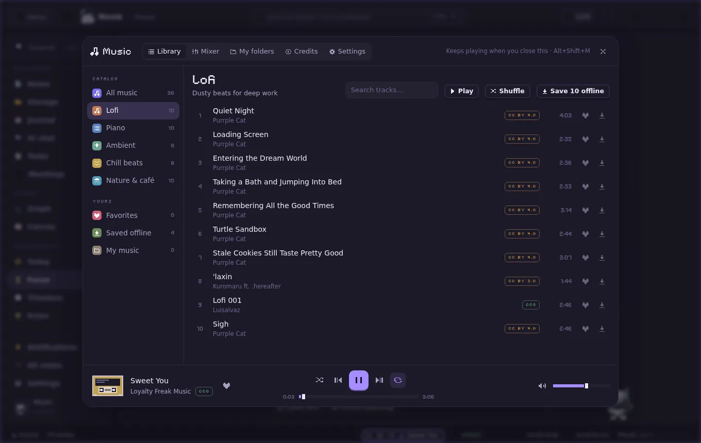
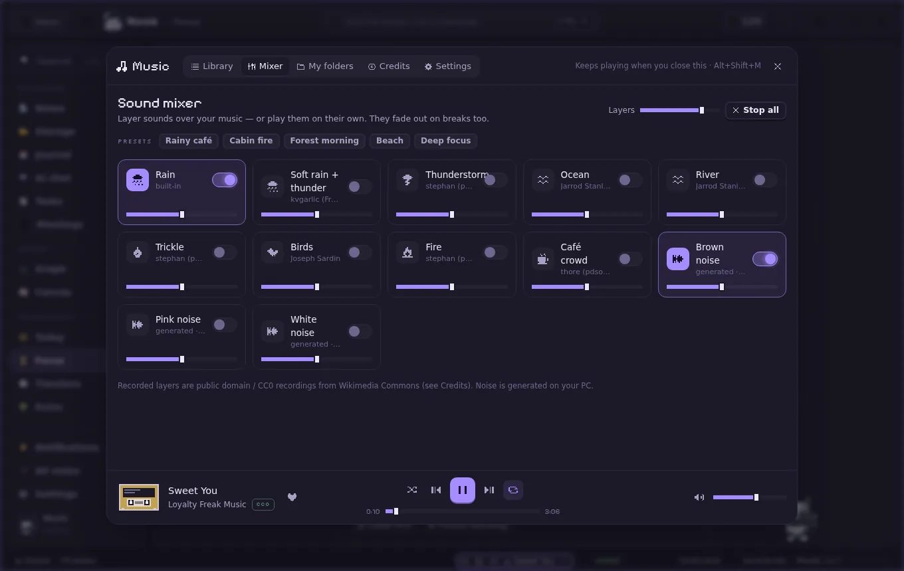
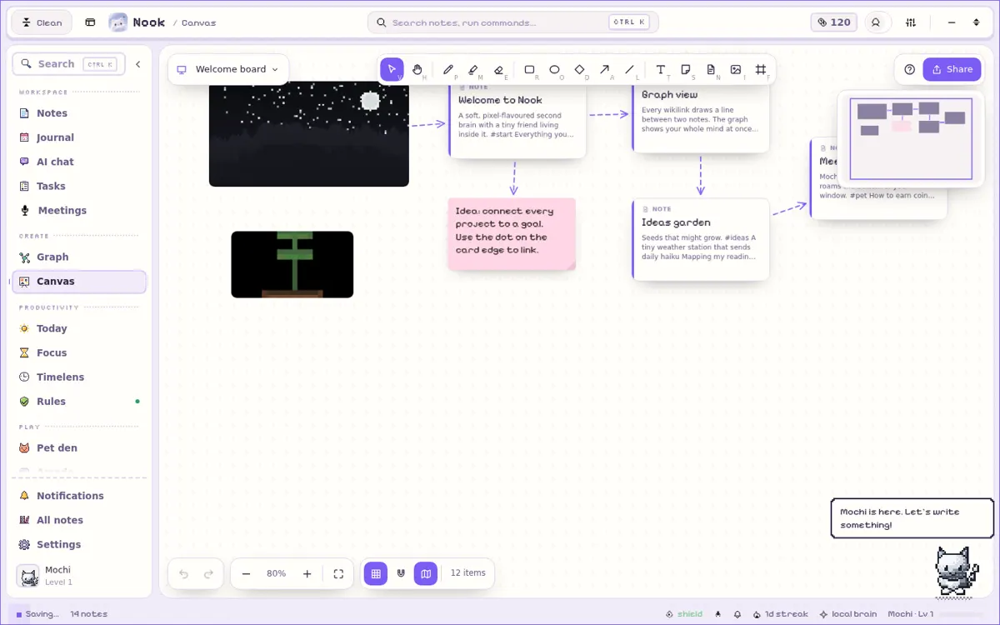
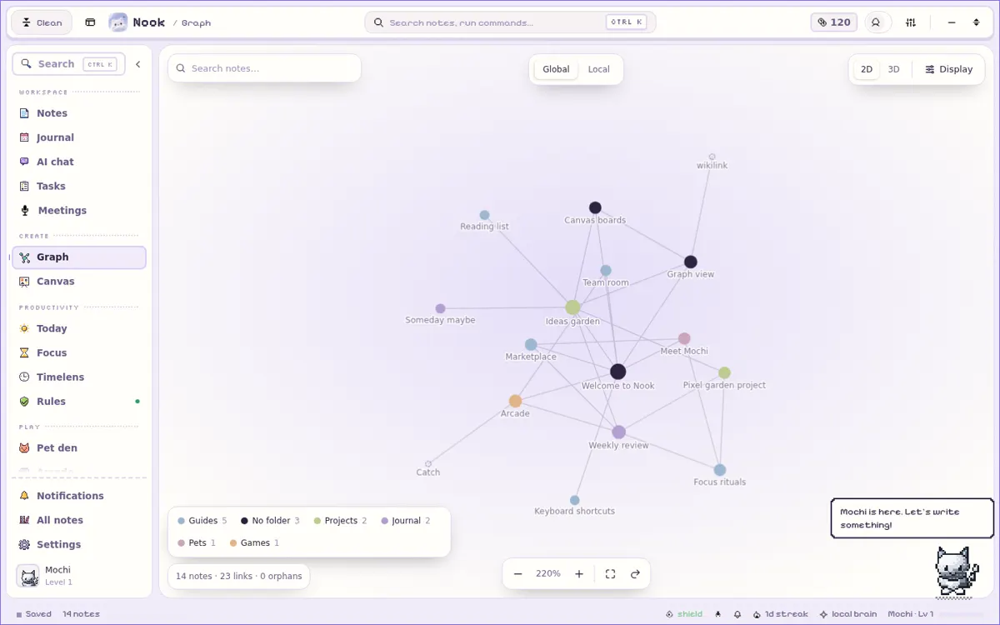
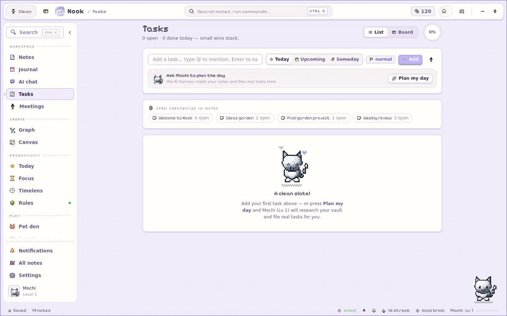
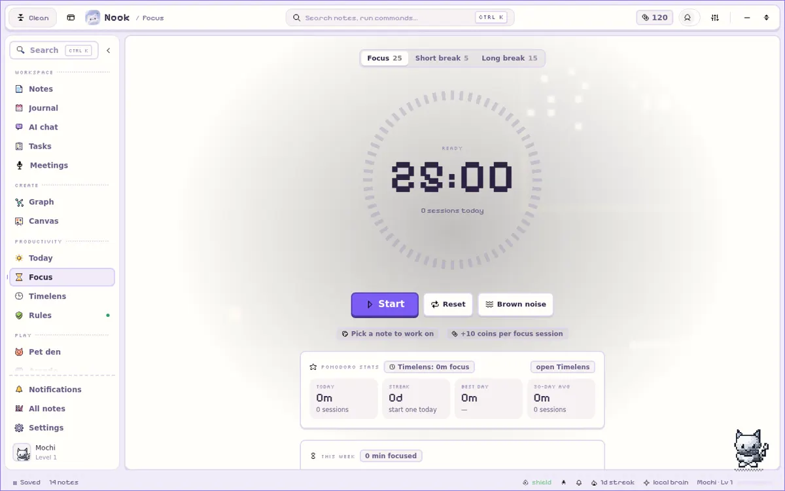
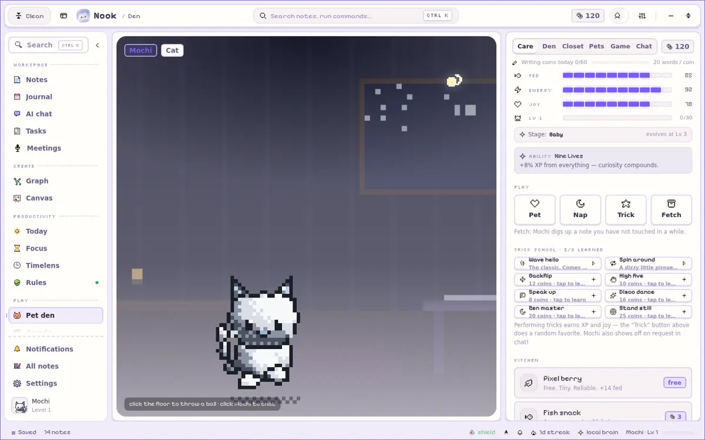

  <picture>
    <source media="(prefers-color-scheme: light)" srcset="assets/banner-light.webp">
    
  </picture>

<h1 align="center"> Nook</h1>

  <b>A cozy, pixel-flavoured second brain for Windows.</b> 
  Markdown notes, tasks, focus timer and music, a desktop pet that roams your screen, 
  voice dictation into any app, and notes that sync to the web by themselves.

  

  
  
  

  <a href="https://nook-web-7cj.pages.dev">Website</a> ·
  <a href="https://nook-web-7cj.pages.dev/changelog">What's new</a> ·
  <a href="https://github.com/MrRealORG/nook-releases/releases">All releases</a> ·
  <a href="https://nook-web-7cj.pages.dev/bug">Report a bug</a>

---

  

## What's new in 1.7

| | |
|---|---|
| 🐈 **Desktop pet, everywhere** | Opt-in: your pet leaves the window and roams the whole desktop — every monitor, never under the taskbar, clicks pass through around it, and it hides while a full-screen app is in front. Walk anywhere or *gravity & climbing* mode, new run / sit / jump / climb / purr animations, resizable, right-click menu and a status card. |
| 🎙️ **Nook Voice** | Hold **Ctrl + Win**, speak, let go — the text is typed wherever your cursor is, in any app. Local Whisper models you choose (Tiny to Large v3 Turbo), English + Urdu and more, voice history and stats, personal dictionary, snippets, and audio kept only as long as you want (10 / 30 days, custom, or never). Optional AI polish with your own AI provider. Off by default. |
| 🔄 **Auto sync + website tasks** | In Nook Cloud mode, notes and tasks sync by themselves — after changes, at start, when you come back online. Edit your tasks at **/tasks** on the website. Conflicts keep both versions; nothing is silently overwritten. |
| 📝 **Summaries & Cloud AI clean-up** | Summarize notes, meetings and task lists on your PC (local models or an instant mode), or turn a messy note into a clean note plus to-dos. Nook Cloud AI does the same on the server: **free 10 a day, Pro 50 a day**, falling back to the local models when it's used up or you're offline. |
| 🎧 **Focus music** | 46 tracks in Lofi, Piano, Ambient, Chill beats and Nature & café, a mini player in the status bar, a sound mixer (rain, thunder, ocean, fire, café, brown/pink/white noise), auto-play on focus and fade on breaks, your own music folders, offline cache. |
| 🧩 **Widgets** | The desktop widget's pet tile uses the same pet design and colours, plus a new Sticky note tile and focus presets (15 / 25 / 50 min). |
| 🚀 **Onboarding** | New Desktop step (Start with Windows, widget, roaming pet, tray, hotkeys) and Nook Voice step. |
| ⬆️ **Updates by itself** | Nook checks at startup and every 6 hours and shows an **"Update now"** card on its own — one click downloads, installs and restarts. |
| 🐞 **Bug reports fixed** | Reports from the app (Ctrl+Shift+B) and the website send again, also when signed out or in Local-only mode, with the real reason shown if something goes wrong. |

  
  

## Everything else in Nook

**Notes**
- Markdown editor (write / split / read), folders, tags, backlinks, outline, slash menu with templates, quick switcher (Ctrl+O), journal / daily notes, full-text search, version history, Trash with undo.
- Notes are real files: every note is a Markdown file under `Documents\Nook`, synced both ways with other editors.
- Images and attachments in notes, note icons, syntax-highlighted code, Obsidian callouts, table of contents.
- Lock / encrypt notes, flashcards (spaced repetition), OCR, web clipper, reminders, Word export, habit tracker.
- **Live co-editing:** edit a note together with live cursors; owner / editor / viewer roles; public read-only web links.

**Think visually**
- **Canvas:** a real whiteboard — pen, shapes, arrows bound to shapes, stickies, note cards, images, frames, minimap, SVG / PNG export, and live collaboration on shared boards.
- **Graph:** 2D / 3D graph of your notes coloured by folder or tag, with a local graph and search.

**Get things done**
- **Tasks** with Kanban, due dates and recurring reminders; **Today** view.
- **Focus** timer with Pomodoro stats.
- **Timelens:** a local time tracker for apps and websites (with real icons and favicons) — it stays on your PC.
- **Rules:** time limits for apps and sites.
- **Meetings:** record a call (your mic + what you hear), get a speaker-labelled transcript and an AI summary saved as a note.

**AI, your way**
- AI chat and "ask my notes" with any OpenAI-compatible provider (Gemini, GLM, Ollama setup cards), an AI agent that can use MCP servers, and Nook's own MCP server for other AI tools.

**Play & community**
- A desktop pet with a Den, coins and levels; an arcade with pixel games, including eleven pet games starring your own pet.
- **Nook Cloud (optional):** Google / email sign-in, public profiles and Flex card, leaderboards, teams with real-time chat and a shared team note, 100 MB of cloud note storage and **Nook Drive** for files.
- Integrations: Google Drive, Calendar and Tasks, Obsidian, Notion, Todoist, GitHub issues, webhooks, Discord Rich Presence.

  
  

  
  
  

The full list of changes is in the [changelog](https://nook-web-7cj.pages.dev/changelog).

## System requirements

- **Windows 10 or Windows 11, 64-bit (x64).**
- **Microsoft Edge WebView2 Runtime** — already part of Windows 11 and up-to-date Windows 10; if it's missing, the installer downloads it for you.
- Extra disk space only for the speech models or offline music you choose to download.

## Install

1. Download **[Nook_1.7.0_x64-setup.exe](https://github.com/MrRealORG/nook-releases/releases/latest/download/Nook_1.7.0_x64-setup.exe)**.
2. Run it. It installs for your Windows user only — no admin rights needed.
3. **Windows SmartScreen** may say *"Windows protected your PC"* because the installer isn't code-signed with a paid certificate yet. Click **More info → Run anyway**. Every update Nook installs is checked against Nook's own update signature.

## Updates

Nook updates itself. It checks for a new version when it starts and every 6 hours, then shows a **"Nook X.Y.Z is available"** card with the release notes — **Update now** installs and restarts in one click, **Later** asks again at the next check. You can turn automatic checks off in Settings ▸ About.

> Coming from 1.6.2 or older? Those versions check when Nook starts (at most every 6 hours) and show the same card — or use **Settings ▸ About ▸ Check for updates**. You can also just run the new installer over the old one; your notes stay where they are.

## Found a bug?

Press **Ctrl+Shift+B** in Nook, or use the [bug report page](https://nook-web-7cj.pages.dev/bug) — no account needed.

## Music credits & licences

Nook Music uses only **public domain, CC0 and CC BY** music. Every track lists its author, licence and source in the app (**Music ▸ Credits**), where CC BY artists are credited. The interface sounds are CC0 (Kenney).

## About

Nook is made by **Ahmad Raza (MrReal)** — [ahmadraza.cv](http://ahmadraza.cv/).
This repository holds only the public installers and the auto-update feed (`latest.json`); there is no source code here.
